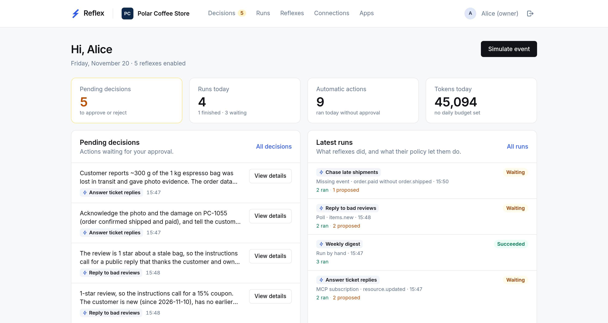
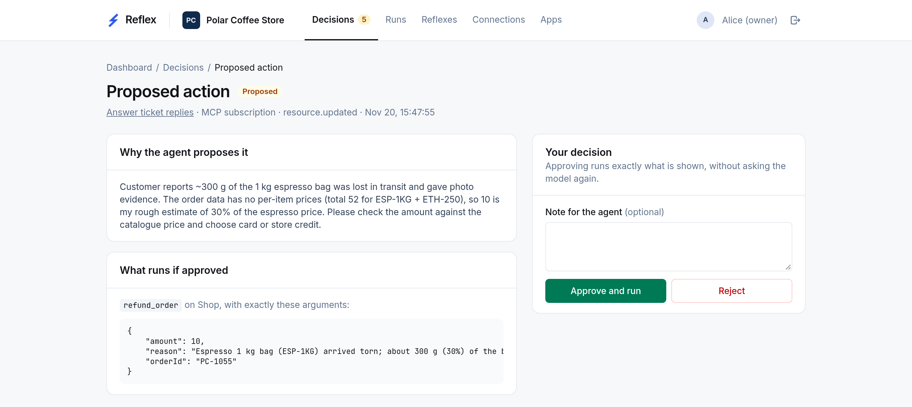
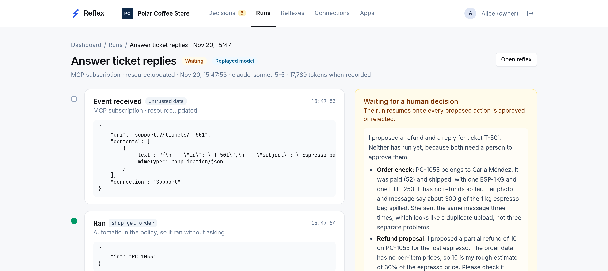
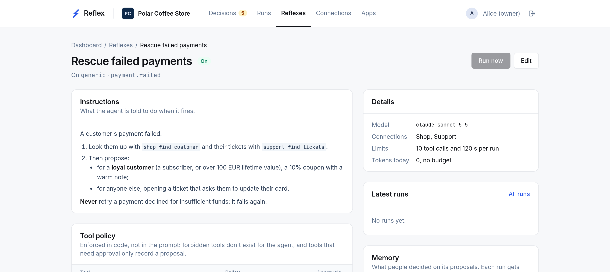
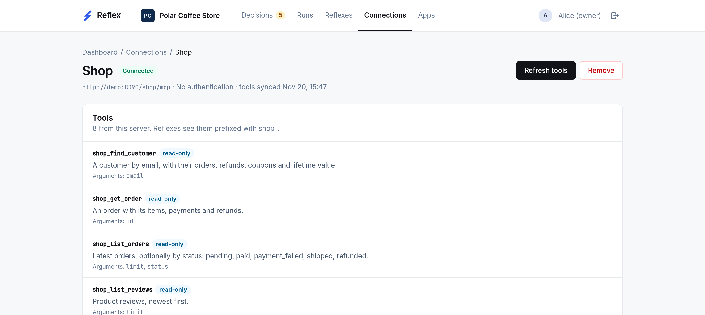
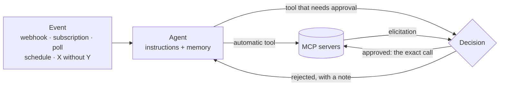

<p align="center">
    <picture>
        <source media="(prefers-color-scheme: dark)" srcset="docs/images/logo-dark.png" />
        
    </picture>
</p>

<h3 align="center">Your systems change. Reflex acts. You decide.</h3>

<p align="center">Event-driven AI agents · Built for the Symfony AI &amp; MCP Hackathon</p>

<p align="center">
    <a href="https://github.com/odiseoteam/reflex/actions/workflows/ci.yaml"></a>
    
    
    
    <a href="LICENSE"></a>
</p>

## Introduction

Reflex is a self-hosted Symfony app whose agents react to your systems' events over MCP. Each reflex acts on its own where its tool policy allows it, and escalates the big decisions to people.

A payment fails, a customer replies on a ticket, an order doesn't ship in time: a reflex wakes up, reads what it needs through MCP tools, does the safe part, and proposes the rest.

<p align="center">
    
</p>

<details>
<summary>
 More screenshots
</summary> <br />

<table>
    <tr>
        <td width="50%" align="center">
            
            <br /><sub><b>Decision:</b> The exact call that runs if you approve it</sub>
        </td>
        <td width="50%" align="center">
            
            <br /><sub><b>Run:</b> The event, each tool call and the agent's summary</sub>
        </td>
    </tr>
    <tr>
        <td width="50%" align="center">
            
            <br /><sub><b>Reflex:</b> Instructions in Markdown and a policy per tool</sub>
        </td>
        <td width="50%" align="center">
            
            <br /><sub><b>Connection:</b> An MCP server and the tools it brings</sub>
        </td>
    </tr>
</table>

</details>

## Built with

Reflex was built to put Symfony AI and the MCP PHP SDK through a real app, end to end.

### Symfony AI

- **Agent and Toolbox** - The agent loop of each run, with a toolbox of our own that applies the tool policy
- **Agent MCP bridge** - `McpToolbox` turns the tools of each MCP connection into tools of the agent
- **Platform** - Anthropic and Hugging Face, picked per reflex, and the Generic bridge for a local embeddings server (Text Embeddings Inference)
- **Platform recording** - `ResultSerializer` records model answers and replays them, so the demo runs without a key
- **Store** - The Doctrine bridge, a vectorizer and a retriever keep the memory of past decisions in pgvector
- **AI Bundle and MCP Bundle** - Configuration of all of the above, and Reflex's own MCP server

### MCP PHP SDK

- **Client** - Streamable HTTP, OAuth, tools and resources of every connection
- **Resource subscriptions** - `subscriptions/listen`, added to the SDK's client in a fork, fire reflexes when a resource changes
- **Elicitation** - A question a server asks mid-call becomes a decision for a person, and the call is repeated with the answer
- **Server** - Tools with annotations, behind Reflex's own OAuth 2.1 server (PKCE and dynamic client registration)

### Symfony

- **Messenger** runs reflexes in a worker, and resumes them after a crash
- **Scheduler** fires schedules, polls and "X without Y" windows, and prunes old runs
- **Webhook and RemoteEvent** receive signed events from GitHub, Stripe or any source
- **Workflow** moves decisions from proposed to approved, rejected or executed
- **Security** handles roles, CSRF and the OAuth server, with **Rate Limiter** in front of it
- **Twig Components, Turbo and Stimulus** build the UI with Tailwind through AssetMapper, without a Node build

It runs on Symfony 8.1 and FrankenPHP in worker mode, PHP 8.5 and PostgreSQL 18 with pgvector.

## Getting Started

### Try the demo in 5 steps ⚡

The demo company is **Polar Coffee Store**, a small online coffee shop with its own shop and helpdesk MCP servers, bundled in the repository.

1. Clone and start it

    ```bash
    git clone https://github.com/odiseoteam/reflex.git && cd reflex
    docker compose up --wait
    ```

2. Set up the demo company: its people, MCP connections and five reflexes

    ```bash
    docker compose exec php bin/console reflex:demo:setup
    ```

3. Sign in at <http://localhost:8088> as `alice@polarcoffee.test`, password `polarcoffee`
4. Click **Simulate event** and pick one, e.g. a failed payment for Ana
5. Open the decision it proposes, then approve or reject it

> [!NOTE]
> Without an API key, runs replay recorded model answers and show a **Replayed model** badge. The recordings cover every approve and reject path of the [demo scenarios](docs/demo.md).

### Use a real model

Put a key in `.env.local`, then restart the app and the worker with `docker compose restart php worker`:

```dotenv
# Claude Sonnet, Opus or Haiku, the models of the demo reflexes
ANTHROPIC_API_KEY=sk-ant-...
# openai/gpt-oss-120b through Hugging Face Inference Providers, picked per reflex in its form
HF_TOKEN=hf_...
```

With a key, runs of that model's reflexes go to it live, and they can also be run by hand.

### Connect an MCP client

Reflex is an MCP server too, behind OAuth. Add it to Claude Code, sign in, and choose what the app may do:

```bash
claude mcp add --transport http reflex http://localhost:8088/mcp
```

Its tools list and create reflexes, read runs, and approve, reject or answer decisions as you. Connected apps are listed, and can be disconnected, on the **Apps** page.

## Documentation

- 🎬 **[Demo scenarios](docs/demo.md)** - What each simulated event does, who the people are, and which paths are recorded
- ⚡ **[Triggers](docs/triggers.md)** - Webhooks, MCP subscriptions, polls, "X without Y" and schedules, and how to set each one up
- 🛡️ **[Policies and decisions](docs/policies-and-decisions.md)** - Tool policies, approvals, server questions, memory and limits
- ⚙️ **[Configuration](docs/configuration.md)** - Environment variables, console commands and development

## How it works



A reflex is an event to react to, instructions for the agent, the MCP connections whose tools it gets, and a policy per tool:

| Policy | What the agent gets | What happens |
| --- | --- | --- |
| Automatic | The tool | It runs, and the result goes back to the agent |
| Needs approval | A tool that proposes the call | A decision waits for a person; the run resumes once every proposal is decided |
| Forbidden | Nothing | The tool doesn't exist for the agent |

The policy lives in code, not in the prompt, and approving runs exactly the call that was shown, without asking the model again. Events, decision outcomes and memory reach the model marked as data, never instructions.

Runs are queued with Messenger and survive a worker crash: each step is stored, and a resumed run reuses the steps it already made.

## Develop

```bash
docker compose exec php composer ci        # PHP CS Fixer, PHPStan and PHPUnit
docker compose exec php composer cs:fix    # fix the code style
```

## License

[MIT](LICENSE).
